<h1 align="center">Welcome to Voronoi Stats</h1>

<p align="center">
  
</p>

<p align="center">
  <b>Your languages, repositories and weekly activity as an animated Voronoi map for your GitHub profile.</b>
</p>

<p align="center">
  
  
  
  
  
</p>

---

Do you want a profile card that shows what you actually write, instead of a plain bar of percentages? Then you are in the right place!

Voronoi Stats reads your repositories and your activity from the GitHub API and draws a **territory map**: each programming language is a territory, each repository is a cell inside it, and the size of everything follows the amount of code. Next to the map, four line charts show your last 12 months of commits, pull requests, issues and reviews. The result is a single `.svg` file, regenerated automatically every day by a GitHub Action.

It is also as light as it can be: **plain Python, no external dependencies** (only the standard library).

## Table of Contents

- [🧭 How to Read the Card](#how-to-read-the-card)
- [🚀 How to Use](#how-to-use)
  - [Step 1: Copy the `voronoi-stats/` folder](#step-1-copy-the-voronoi-stats-folder)
  - [Step 2: Create the GitHub Actions workflow](#step-2-create-the-github-actions-workflow)
  - [Step 3: Add a `.gitignore`](#step-3-add-a-gitignore)
  - [Step 4: Create the access token](#step-4-create-the-access-token)
  - [Step 5: Save the token as a repository secret](#step-5-save-the-token-as-a-repository-secret)
  - [Step 6: Run the pipeline](#step-6-run-the-pipeline)
  - [Step 7: Show the card in your profile](#step-7-show-the-card-in-your-profile)
  - [Optional: run it on your computer](#optional-run-it-on-your-computer)
- [🛠️ Customization](#customization)
  - [What you can change](#what-you-can-change)
  - [Constants reference](#constants-reference)
- [🎨 Themes](#themes)
  - [1. Dark Colors](#1-dark-colors)
  - [2. Light Colors (Pastels)](#2-light-colors-pastels)
  - [3. Nature & Seasons](#3-nature--seasons)
  - [4. Drinks](#4-drinks)
  - [5. Countries & Geography](#5-countries--geography)
  - [6. Aesthetics & Culture](#6-aesthetics--culture)
  - [7. Classical UI (Dev Themes)](#7-classical-ui-dev-themes)
  - [8. Mythology & Concepts](#8-mythology--concepts)
- [🩺 Troubleshooting](#troubleshooting)

---

## How to Read the Card

| What you see | What it means |
| --- | --- |
| **Territory** (a large colored region) | One programming language. The legend shows its color and its real share of your code. |
| **Territory area** | The amount of code in that language. Small languages get a minimum of 2.5% of the area so they stay visible, which is why the legend shows the real percentages. |
| **Cell** (a piece inside a territory) | One repository, in that language. A repository that uses several languages appears once in each of its territories. |
| **Cell opacity** | How recent the last push was, compared to your other repositories. Faint cells have the oldest pushes, solid cells have the newest. It is measured in whole weeks, so it does not change every day. |
| **Lines on the right** | Weekly activity for the last 12 months: commits, pull requests, issues and reviews. The big number is the 12-month total, and the pulsing dot marks the current week. |
| **REPOS / STARS / FORKS** | Totals of the repositories used in the map. |

Some rules about the data:

- Only your **top 5 languages** get their own territory. All the others are grouped into **Other**.
- **Forks and archived repositories** are left out.
- **Private repositories** are only included if the token has the `repo` permission (see [Step 4](#step-4-create-the-access-token)).

<p align="right"><a href="#table-of-contents">⬆ back to top</a></p>

---

## How to Use

Follow the steps below in order. In the end you will have a card that updates itself every day, with no manual work.

> [!NOTE]
> Everything below happens in your **profile repository**, the special repository named exactly like your GitHub username (for example, `Bob/Bob`).

### Step 1: Copy the `voronoi-stats/` folder

See the `voronoi-stats/` folder in this repository? Copy the **entire folder** to the root of your profile repository.

### Step 2: Create the GitHub Actions workflow

Create a `.github/workflows` folder in the root of the repository and add a file called `voronoi-stats.yml` to it, with the following content:

```yml
name: voronoi-stats

on:
  schedule:
    - cron: "0 6 * * *"
  workflow_dispatch:

permissions:
  contents: write

concurrency:
  group: voronoi-stats
  cancel-in-progress: false

env:
  USERNAME: ${{ github.repository_owner }}
  THEME: cyberpunk

jobs:
  update:
    runs-on: ubuntu-latest
    steps:
      - name: Download repository
        uses: actions/checkout@v7

      - name: Install python
        uses: actions/setup-python@v6
        with:
          python-version: "3.12"

      - name: Generate svg card
        env:
          GH_TOKEN: ${{ secrets.GH_TOKEN }}
        run: python -m voronoi_stats "$USERNAME" --theme "$THEME"

      - name: Save to repository if changed
        run: |
          if [ -z "$(git status --porcelain assets/stats.svg)" ]; then
            echo "No updates were found."
          else
            git config user.name "github-actions[bot]"
            git config user.email "41898282+github-actions[bot]@users.noreply.github.com"
            git pull
            git add assets/stats.svg
            git commit -m "auto: update voronoi stats"
            git push
          fi
```

This workflow runs **every day at 06:00 UTC** and can also be started manually (`workflow_dispatch`). When something changes, it commits the new `assets/stats.svg` file by itself.

> [!WARNING]
> `USERNAME` defaults to the owner of the repository, which is correct for a profile repository. `THEME` accepts any of the names listed in the [Themes](#themes) section, so feel free to test all of them.

> [!NOTE]
> Python 3.12 is recommended. The code needs Python 3.9 or newer.

### Step 3: Add a `.gitignore`

You may also need a `.gitignore` file in the root of the repository, with at least the following lines:

```gitignore
__pycache__/
*.pyc
.DS_Store
```

### Step 4: Create the access token

The script needs permission to read your repositories and your activity. For that, create a **classic** personal access token:

1. Open **GitHub → Settings → Developer settings → Personal access tokens → Tokens (classic)**.
2. Click **Generate new token (classic)**.
3. Give it a name (for example, `voronoi-stats`) and select the `read:user` permission.
4. *(Optional)* If you want your **private repositories** in the map, also select `repo`. Without it, only public repositories are used.
5. Click **Generate token** and **copy it right away**, because GitHub will not show it again.

> [!IMPORTANT]
> Never commit the token to the repository. It must live only in the repository secrets, as shown in the next step.

> [!CAUTION]
> If the token expires, the automation will stop working, and a new token must be generated to restore functionality.

### Step 5: Save the token as a repository secret

With the token copied:

1. Go to your profile repository on GitHub and open **Settings → Secrets and variables → Actions**.
2. Click **New repository secret**.
3. In **Name**, type exactly `GH_TOKEN`.
4. In **Secret**, paste the token you just created.
5. Click **Add secret**.

### Step 6: Run the pipeline

1. Open the **Actions** tab of the repository.
2. Select the **voronoi-stats** workflow.
3. Click **Run workflow**.

When the automation finishes, an `assets/` folder will be created with the `stats.svg` file inside it.

### Step 7: Show the card in your profile

Finally, add the following to your profile `README.md`:

```html
<p align="center">
  <a href="https://github.com/JonatasCortes/voronoi-stats">
    
  </a>
</p>
```

Set the `width` value that best suits your README, then **commit and push** the change.

> [!TIP]
> From now on you do not need to do anything else: the card will be refreshed every day automatically. 🎉

### Optional: run it on your computer

With the `GH_TOKEN` variable defined in your terminal, you can also generate the card locally, from the root of your profile repository:

```bash
python -m voronoi_stats YourGithubUser --theme ThemeName
```

The file is saved to `assets/stats.svg`.

<p align="right"><a href="#table-of-contents">⬆ back to top</a></p>

---

## Customization

Voronoi Stats was made to be adjusted to your taste, and there are two levels of customization.

### What you can change

| What | How | Where |
| --- | --- | --- |
| **Colors and visual style** | Pick a ready-made theme | `THEME` in the workflow → see [Themes](#themes) |
| **A new theme** | Add an entry to `THEMES` (name in lowercase, without spaces, `-` or `_`) | `voronoi-stats/themes.py` |
| **Anything else** (animation time, texts, sizes, opacity...) | Edit the constants | `voronoi-stats/constants.py` |

> [!NOTE]
> Any customization different from the ready-made [themes](#themes) must be done by modifying the file **`voronoi-stats/constants.py`**.

A theme does not choose the color of each language directly. Instead, it defines the **color range** the languages are picked from: a start hue, an end hue, a saturation and a lightness. The biggest language gets the start of the range, the smallest gets the end, and the others are spread in between. This way a green theme gives you green-ish languages, a purple theme gives you purple-ish ones, and so on. Each theme also defines two legend colors: `legend_title` (for "Area:", "Cell:" and "Opacity:") and `legend_text` (for the explanations and the language names).

In `constants.py` you can, for example, change how long the animation takes, translate every text of the card (title, legend, labels and number format) or change how many languages get their own territory.

### Constants reference

Here is what each group of constants is for:

| Group | Constants | What it controls |
| --- | --- | --- |
| **Texts** | `LABELS`, `THOUSANDS_SEP`, `DECIMAL_SEP`, `PERCENT_DECIMALS` | Every text of the card (title, legend titles and explanations, labels, accessibility description) and how numbers are written (`2,847` and `91.2%` by default) |
| **Data rules** | `MAX_LANGUAGES`, `OTHER_LABEL`, `MIN_AREA_SHARE`, `OPACITY_MIN`, `OPACITY_MAX` | How many languages get a territory, the minimum area of a territory, and the opacity range of the cells |
| **Animation** | `ANIM_CELL_*`, `ANIM_TERRITORY_*`, `ANIM_SPARK_*`, `ANIM_NUM_*`, `ANIM_PULSE_*` | How long each part of the animation takes (in seconds) and when it starts |
| **Drawing** | `CELL_STROKE_W`, `TERRITORY_*`, `SPARK_*`, `GLOW_*`, `*_OPACITY` | Line thickness, the size of the dot at the end of the charts, background glow and the transparency of the small elements |
| **Typography** | `FONT_FAMILY`, `FONT_*` | The font and the size of every text |
| **Card layout** | `CARD_W`, `PAD`, `HEADER_*`, `PLOT_*`, `LEGEND_*`, `ACTIVITY_*`, `FOOTER_STATS_H` | The size of the card and the position and spacing of the map, the legend (row height, color squares, opacity scale) and the activity column |
| **Geometry** | `POWER_MAX_ITER`, `POWER_TOLERANCE`, `POWER_STEP`, `SEED_MARGIN`, `DOMINANT_SHARE` | How the map is calculated and how the biggest language is placed |
| **Output and GitHub API** | `OUTPUT_PATH`, `TOKEN_ENV`, `GRAPHQL_URL`, `REPOS_PAGE_SIZE`, `LANGS_PER_REPO` | Where the SVG is saved, the name of the token variable and how the data is requested from GitHub |

> [!TIP]
> The easiest and most noticeable changes are the animation times (`ANIM_*`) and `MAX_LANGUAGES`. Try `MAX_LANGUAGES = 3` for a cleaner map.

> [!CAUTION]
> Be careful with the **Card layout**, **Geometry** and **Output and GitHub API** groups. Changing them can misalign the card or break the data download. If something goes wrong, restore the original values. Also remember that:
> - each legend explanation must fit in one line of the card (about 100 characters), so keep your translations short;
> - if you change `OUTPUT_PATH`, update the `git status` and `git add` paths in the workflow;
> - if you change `TOKEN_ENV`, update the `GH_TOKEN` name in the workflow.

<p align="right"><a href="#table-of-contents">⬆ back to top</a></p>

---

## Themes

> [!NOTE]
> Theme names are not case sensitive, and spaces, hyphens (`-`) and underscores (`_`) are ignored. So `"japan_light"`, `"Japan-Light"` and `"JAPANLIGHT"` all select the same theme.

Jump straight to a category:

<table align="center">
  <thead>
    <tr>
      <th align="center">🎨 Dark Colors</th>
      <th align="center">💡 Light Colors</th>
      <th align="center">🍂 Nature & Seasons</th>
      <th align="center">🍷 Drinks</th>
    </tr>
  </thead>
  <tbody>
    <tr>
      <td align="center"><a href="#1-dark-colors"><b>Explore ↗</b></a></td>
      <td align="center"><a href="#2-light-colors-pastels"><b>Explore ↗</b></a></td>
      <td align="center"><a href="#3-nature--seasons"><b>Explore ↗</b></a></td>
      <td align="center"><a href="#4-drinks"><b>Explore ↗</b></a></td>
    </tr>
  </tbody>
  <thead>
    <tr>
      <th align="center">🌍 Countries & Geo</th>
      <th align="center">🌸 Aesthetics & Culture</th>
      <th align="center">💻 Classical UI (Dev)</th>
      <th align="center">✨ Mythology</th>
    </tr>
  </thead>
  <tbody>
    <tr>
      <td align="center"><a href="#5-countries--geography"><b>Explore ↗</b></a></td>
      <td align="center"><a href="#6-aesthetics--culture"><b>Explore ↗</b></a></td>
      <td align="center"><a href="#7-classical-ui-dev-themes"><b>Explore ↗</b></a></td>
      <td align="center"><a href="#8-mythology--concepts"><b>Explore ↗</b></a></td>
    </tr>
  </tbody>
</table>

### 1. Dark Colors

Simple, bold, and deep classic colors. 
Available themes: [`red`](#red) · [`orange`](#orange) · [`yellow`](#yellow) · [`green`](#green) · [`blue`](#blue) · [`purple`](#purple) · [`pink`](#pink) · [`obsidian`](#obsidian)

#### Red
`--theme red`
<p align="center"></p>

#### Orange
`--theme orange`
<p align="center"></p>

#### Yellow
`--theme yellow`
<p align="center"></p>

#### Green
`--theme green`
<p align="center"></p>

#### Blue
`--theme blue`
<p align="center"></p>

#### Purple
`--theme purple`
<p align="center"></p>

#### Pink
`--theme pink`
<p align="center"></p>

#### Obsidian
`--theme obsidian`
<p align="center"></p>

<p align="right"><a href="#themes">⬆ back to themes</a></p>

---

### 2. Light Colors (Pastels)

Beautifully tinted light backgrounds for a clean and fresh look. 
Available themes: [`mint`](#mint) · [`chocomint`](#choco-mint) · [`lavender`](#lavender) · [`peach`](#peach) · [`sky`](#sky)

#### Mint
`--theme mint`
<p align="center"></p>

#### Choco Mint
`--theme chocomint`
<p align="center"></p>

#### Lavender
`--theme lavender`
<p align="center"></p>

#### Peach
`--theme peach`
<p align="center"></p>

#### Sky
`--theme sky`
<p align="center"></p>

<p align="right"><a href="#themes">⬆ back to themes</a></p>

---

### 3. Seasons

Earthy and atmospheric palettes inspired by the natural world. 
Available themes: [`spring`](#spring) · [`summer`](#summer) · [`autumn`](#autumn) · [`winter`](#winter)

#### Spring
`--theme spring`
<p align="center"></p>

#### Summer
`--theme summer`
<p align="center"></p>

#### Autumn
`--theme autumn`
<p align="center"></p>

#### Winter
`--theme winter`
<p align="center"></p>

<p align="right"><a href="#themes">⬆ back to themes</a></p>

---

### 4. Drinks

Warm tones and aesthetics inspired by classic beverages. 
Available themes: [`wine`](#wine) · [`beer`](#beer) · [`coffee`](#coffee) · [`matcha`](#matcha) · [`berrymatcha`](#berry-matcha) · [`latte`](#latte)

#### Wine
`--theme wine`
<p align="center"></p>

#### Beer
`--theme beer`
<p align="center"></p>

#### Coffee
`--theme coffee`
<p align="center"></p>

#### Matcha
`--theme matcha`
<p align="center"></p>

#### Berry Matcha
`--theme berrymatcha`
<p align="center"></p>

#### Latte
`--theme latte`
<p align="center"></p>

<p align="right"><a href="#themes">⬆ back to themes</a></p>

---

### 5. Countries & Geography

Colors inspired by flags and cultural landmarks. 
Available themes: [`brazil`](#brazil) · [`usa`](#usa) · [`miami`](#miami) · [`france`](#france) · [`japan_dark`](#japan_dark) · [`japan_light`](#japan_light) · [`sakura`](#sakura) · [`india`](#india) · [`china`](#china) · [`mexico`](#mexico) · [`fiesta`](#fiesta) · [`greece`](#greece) · [`egypt`](#egypt)

#### Brazil
`--theme brazil`
<p align="center"></p>

#### USA
`--theme usa`
<p align="center"></p>

#### MIAMI
`--theme miami`
<p align="center"></p>

#### France
`--theme france`
<p align="center"></p>

#### Japan Dark
`--theme japan_dark`
<p align="center"></p>

#### Japan Light
`--theme japan_light`
<p align="center"></p>

#### Sakura
`--theme sakura`
<p align="center"></p>

#### India
`--theme india`
<p align="center"></p>

#### China
`--theme china`
<p align="center"></p>

#### Mexico
`--theme mexico`
<p align="center"></p>

#### Fiesta
`--theme fiesta`
<p align="center"></p>

#### Greece
`--theme greece`
<p align="center"></p>

#### Egypt
`--theme egypt`
<p align="center"></p>

<p align="right"><a href="#themes">⬆ back to themes</a></p>

---

### 6. Aesthetics & Culture

Highly stylized themes based on internet cultures and artistic movements. 
Available themes: [`neon`](#neon) · [`cyberpunk`](#cyberpunk) · [`steampunk`](#steampunk) · [`synthwave`](#synthwave) · [`lofi`](#lofi)

#### Neon
`--theme neon`
<p align="center"></p>

#### Cyberpunk
`--theme cyberpunk`
<p align="center"></p>

#### Steampunk
`--theme steampunk`
<p align="center"></p>

#### Synthwave
`--theme synthwave`
<p align="center"></p>

#### Lofi
`--theme lofi`
<p align="center"></p>

<p align="right"><a href="#themes">⬆ back to themes</a></p>

---

### 7. Classical UI (Dev Themes)

Beloved themes from your favorite code editors and IDEs. 
Available themes: [`dracula`](#dracula) · [`mocha`](#mocha) · [`nord`](#nord) · [`solarized_dark`](#solarized_dark) · [`solarized_light`](#solarized_light) · [`atlas`](#atlas)

#### Dracula
`--theme dracula`
<p align="center"></p>

#### Mocha
`--theme mocha`
<p align="center"></p>

#### Nord
`--theme nord`
<p align="center"></p>

#### Solarized Dark
`--theme solarized_dark`
<p align="center"></p>

#### Solarized Light
`--theme solarized_light`
<p align="center"></p>

#### Atlas
`--theme atlas`
<p align="center"></p>

<p align="right"><a href="#themes">⬆ back to themes</a></p>

---

### 8. Mythology & Concepts

Epic, concept-driven abstract aesthetics. 
Available themes: [`heaven`](#heaven) · [`hell`](#hell) · [`abyss`](#abyss)

#### Heaven
`--theme heaven`
<p align="center"></p>

#### Hell
`--theme hell`
<p align="center"></p>

#### Abyss
`--theme abyss`
<p align="center"></p>

<p align="right"><a href="#themes">⬆ back to themes</a> · <a href="#table-of-contents">⬆ back to top</a></p>

---

## Troubleshooting

| Problem | What to check |
| --- | --- |
| **The workflow fails with "GitHub rejected the token"** | The token is wrong, expired or was revoked. Create a new one ([Step 4](#step-4-create-the-access-token)) and update the `GH_TOKEN` secret. |
| **"Environment variable GH_TOKEN is empty or missing"** | The secret is not named exactly `GH_TOKEN`, or the workflow does not pass it as `GH_TOKEN`. |
| **"GitHub user not found"** | The username is wrong. In a profile repository, `USERNAME` must be the account that owns it. |
| **"Theme ... not found"** | The `THEME` name does not exist. The error message lists every available theme. |
| **The workflow cannot push the SVG** | Open **Settings → Actions → General → Workflow permissions** and allow **Read and write permissions**. |
| **The card is empty or has few repositories** | Forks and archived repositories are ignored, and private repositories need the `repo` permission on the token. |
| **The card stopped updating after a long time** | GitHub can pause scheduled workflows in repositories with no activity for 60 days. Open the **Actions** tab and enable the workflow again, or run it manually. |

<p align="right"><a href="#table-of-contents">⬆ back to top</a></p>

---

<p align="center">
  Made with 💜 for GitHub profiles. If you liked it, leave a ⭐ on the repository!
</p>